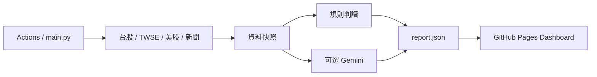
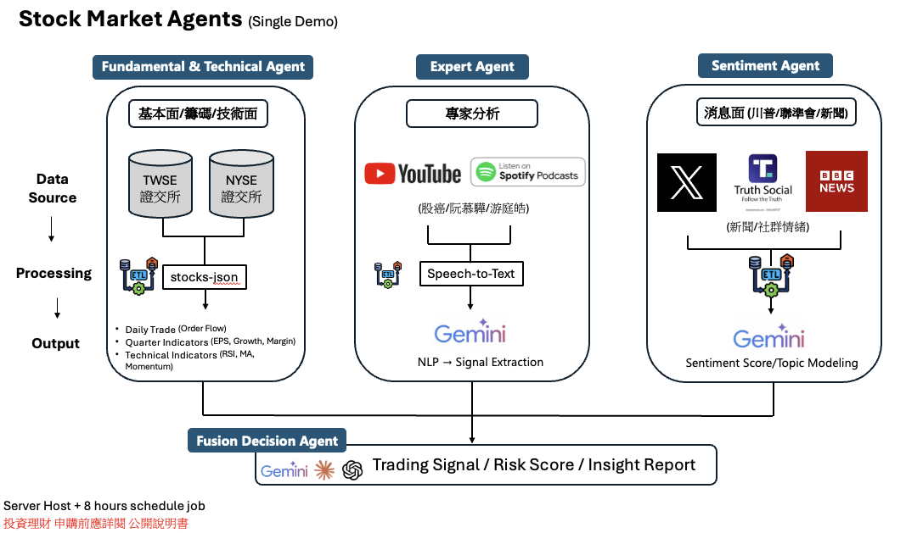

# 架構與 Code Review 導覽

## 建議閱讀順序

1. `main.py`：設定、收集資料、組合策略結果、輸出 JSON、可選推播。
2. `market_insights/`：依外部來源與分析責任拆分的 Python 模組。
3. `dashboard/data/report.json`：已提交的資料快照，GitHub Pages 可直接讀取。
4. `dashboard/app.js`：分頁、共用 UI、台股渲染、資料刷新。
5. `dashboard/us-panel.js`、`strategy-room.js`：美股來源展示與 agent 分析卡。
6. `tests/`：離線驗證主要失敗情境；`.github/workflows/checks.yml` 執行檢查。

## 模組責任

| 模組 | 責任 |
| --- | --- |
| collectors.py | 台股指數、技術、風險與 TWSE 法人／板塊 |
| market_volume.py | 官方成交股數解析、日期對齊與缺值 |
| us_market.py | 美股日線、產業 ETF、追蹤個股及 WSJ RSS |
| channels.py | YouTube 影片與字幕、可選影片摘要 |
| llm.py | Gemini 金鑰初始化與一次有限時的策略請求 |
| strategy.py | 證據快照、規則判讀、可選模型結果與待分析原因 |
| reporting.py | 嚴格 JSON 缺值清理、可選 Telegram |

## 原始設計圖

這是目標架構。當前 agent 卡是獨立研究視角與結構化結果，尚非各自常駐、互相派工的服務。完整財報、Podcast、社群情緒與 Fusion 模型仍待接入。

## Reviewer 應注意的邊界

- 資料規則摘要不需 token；AI 分數只有有效模型回應才會出現。模型失敗保留摘要與待分析原因。
- 沒有數值用 null／待更新表示，JSON 不允許 NaN；缺值不能轉成中性分數。
- TWSE volume 是市場成交股數，不等同 Yahoo 指數成交量。萬張 = 股數 / 10,000,000。
- 美股每筆日線以 America/New_York 日期標示；尚未保證盤中數字是最終收盤。
- 產業 ETF 是代理指標；新聞只有標題與原文連結，未聲稱完成逐篇情緒分析。
- 規則摘要會讀取目前快照，資料過期時摘要也會過期；它不是回測過的交易策略。
- 台／港個股與比較仍使用示範 fixture，已集中檔案並於畫面標示。美股個股改用真實快照，不提供模擬比較圖。
- Google 舊版 SDK 仍保留在獨立 adapter，後續可單獨遷移；目前失敗會降級。
- Taiwan collectors 仍較集中，可在確認資料格式後再細拆；本次先維持演算法行為，避免 review 同時承受大幅重寫。

## 本次整理

移除根目錄未生效的舊 daily_report.yml、重複 README 敘述、註解掉的 Whisper 草稿、重複 import，以及已移除畫面的固定情緒／假貼文與舊策略室渲染程式。正式 workflow 與資料快照保留。
