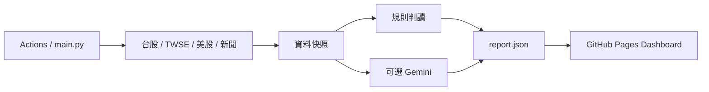

# 架構與 Code Review 導覽

## 建議閱讀順序

1. `main.py`：設定、收集資料、組合策略結果、輸出 JSON、可選推播。
2. `market_insights/`：依外部來源與分析責任拆分的 Python 模組。
3. `dashboard/data/report.json`：已提交的資料快照，GitHub Pages 可直接讀取。
4. `dashboard/app.js`：分頁、共用 UI、台股渲染、資料刷新。
5. `dashboard/us-panel.js`、`strategy-room.js`：美股來源展示與 agent 分析卡。
6. `tests/`：離線驗證主要失敗情境；`.github/workflows/checks.yml` 執行檢查。

## 模組責任

| 模組 | 責任 |
| --- | --- |
| collectors.py | 台股指數、技術、風險與 TWSE 法人／板塊 |
| market_volume.py | 官方成交股數解析、日期對齊與缺值 |
| us_market.py | 美股日線、產業 ETF、追蹤個股及 WSJ RSS |
| channels.py | YouTube 官方 RSS、台灣日期篩選、字幕與可選影片摘要 |
| llm.py | Gemini 金鑰初始化與一次有限時的策略請求 |
| strategy.py | 證據快照、規則判讀、可選模型結果與待分析原因 |
| reporting.py | 嚴格 JSON 缺值清理、可選 Telegram |

## 原始設計圖

這是目標架構。當前 agent 卡是獨立研究視角與結構化結果，尚非各自常駐、互相派工的服務。完整財報、Podcast、社群情緒與 Fusion 模型仍待接入。
